# Sahitya Setu (SIH25240)


User interface prototype for **Sahitya Setu** ("The Literature Bridge"), a proposed offline-first application for translating Nepali and Sinhala documents into English. The concept was created for the Smart India Hackathon under problem statement SIH25240, AI/ML based text-to-text machine translation from Nepalese and Sinhalese to English.

## Overview

A large body of literary and cultural heritage from Nepal and Sri Lanka remains in physical documents that are inaccessible to a global audience. Sahitya Setu is designed to bridge this gap by digitizing documents, translating them with attention to cultural context, and improving through user corrections, while keeping all data on the user's device.

This repository contains the **user interface prototype**: twelve static mobile screens that define the application's end-to-end user journey. The OCR, translation, and storage components described under [Proposed Solution](#proposed-solution) are planned and are not part of this repository.

## Repository Contents

| Area | Contents |
| --- | --- |
| Screen layouts | 12 HTML files, one per screen |
| Screen captures | 12 PNG images matching each layout |
| Application logic | Not included; screens are static |

## Prototype Features

- Onboarding flow covering the welcome screen, sign-in, permissions, and language preferences
- Document input for images and PDF files, presented with an offline, on-device processing message
- Review screen for extracted text before translation
- Translation review showing original and translated text, with a field for suggesting corrections
- Translation history with search and with date and language filters
- Settings for language preferences, security options, and data management
- Consistent mobile layout with dark mode styling

## Technology Stack

| Component | Technology |
| --- | --- |
| Markup | HTML5 |
| Styling | Tailwind CSS, loaded from a CDN |
| Typography and icons | Inter and Material Symbols from Google Fonts, plus inline SVG icons |

## Architecture and Workflow

The screens represent the following intended user journey:

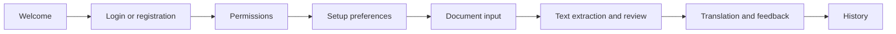

Settings are available from the main navigation alongside Upload and History.

## Project Structure

```text
SIH25240/
├── welcome_screen/
├── login/
│   └── registration_screen/
├── permissions_request/
├── setup_preferences/
├── document_upload_screen/
├── feature_overview__document_input/
├── text_extraction_and_review_screen/
├── feature_overview__translate_&_improve/
├── translation_display_and_feedback_screen/
├── document_history_screen/
├── settings_screen_1/
├── settings_screen_2/
└── README.md
```

Each screen directory contains `code.html` and `screen.png`.

## Installation and Setup

No build step or package installation is required.

```bash
git clone https://github.com/Partha-Shankar/SIH25240.git
cd SIH25240
```

An internet connection is needed to load Tailwind CSS and the web fonts from their CDNs.

## Usage

Open any screen's `code.html` file directly in a web browser. For example, start with `welcome_screen/code.html`. The screens are designed for a mobile viewport, so a browser's device emulation mode gives the most accurate preview.

## Technical Implementation

Each screen is a standalone HTML document with its Tailwind configuration defined inline, so a screen can be opened and edited on its own. The screens share the Inter typeface and a consistent visual style. Navigation controls and form elements are presentational.

## Screenshots

<table>
  <tr>
    <td align="center">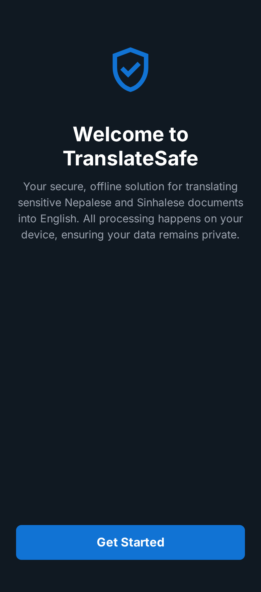<br>Welcome</td>
    <td align="center">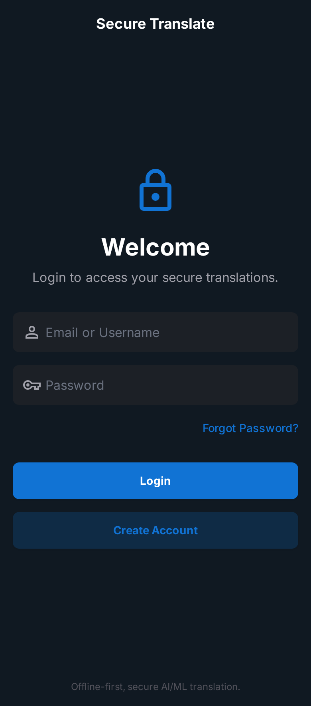<br>Login and Registration</td>
    <td align="center">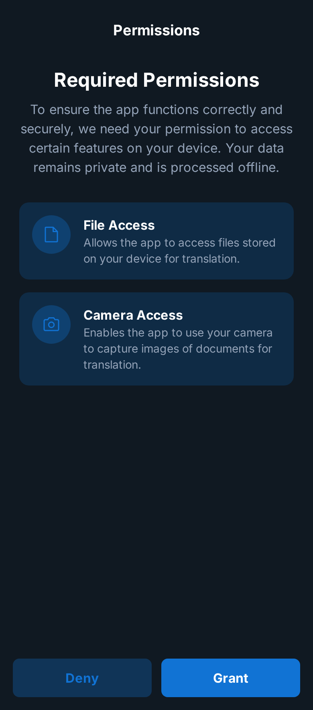<br>Permissions</td>
  </tr>
  <tr>
    <td align="center">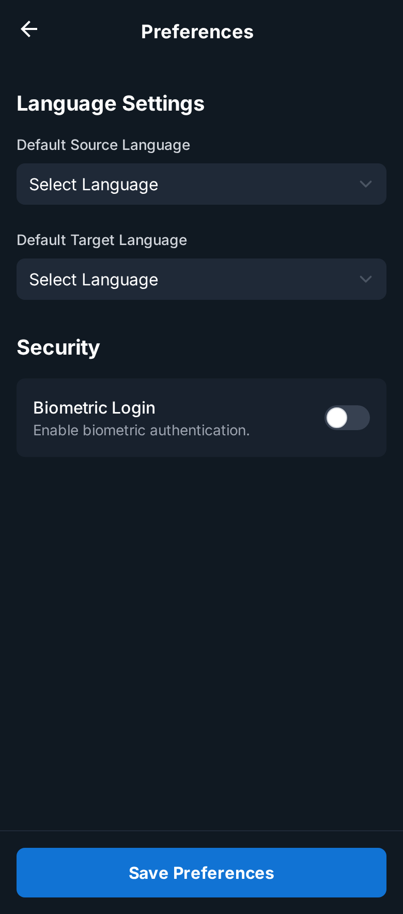<br>Setup Preferences</td>
    <td align="center">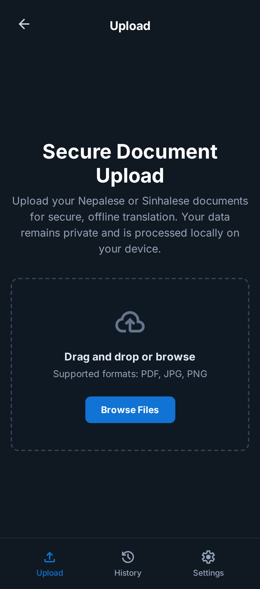<br>Document Upload</td>
    <td align="center">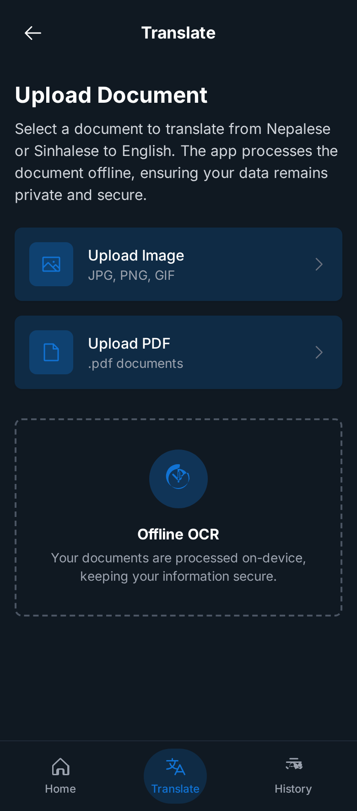<br>Document Input</td>
  </tr>
  <tr>
    <td align="center">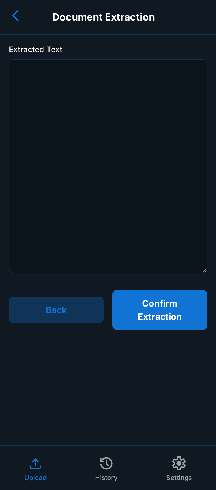<br>Text Extraction and Review</td>
    <td align="center"><br>Translate and Improve</td>
    <td align="center">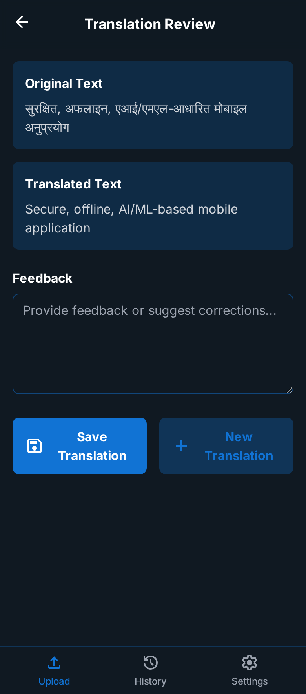<br>Translation and Feedback</td>
  </tr>
  <tr>
    <td align="center">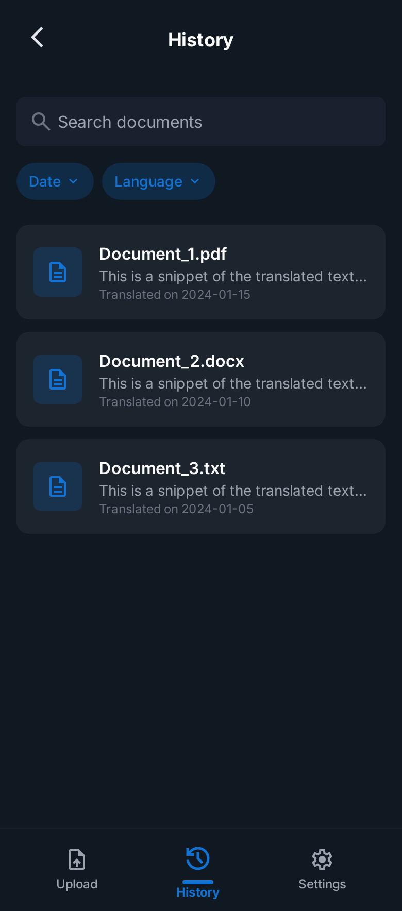<br>History</td>
    <td align="center">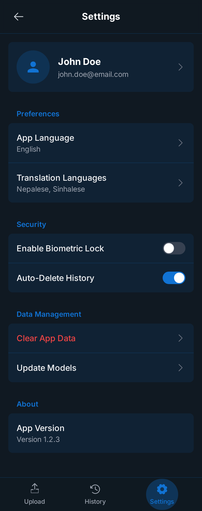<br>Settings (Variant 1)</td>
    <td align="center">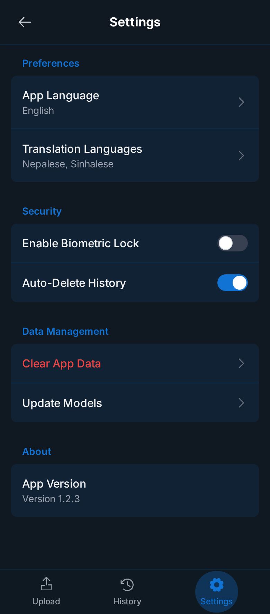<br>Settings (Variant 2)</td>
  </tr>
</table>

## Proposed Solution

The capabilities and technologies in this section describe the intended full application. They are design goals and are not implemented in this repository.

### Planned Capabilities

**OCR engine**

- Recognition of the Devanagari (Nepali) and Sinhala scripts
- Digitization of handwritten manuscripts and historical documents
- Handling of varied print styles and complex page layouts

**Offline translation**

- Pre-trained models, such as Meta's NLLB, running locally
- Preservation of cultural context, idioms, honorifics, and tone
- An experimental poetry mode intended to maintain artistic integrity

**Interactive feedback loop**

- A dual-pane editor for comparing original and translated text
- Corrections saved to a local SQLite database
- A growing parallel corpus for fine-tuning the model over time

**User experience**

- Export as `.txt` or bilingual `.pdf` files
- Text-to-speech output
- Summarization of long documents
- A built-in dictionary, transliteration tools, and a personal phrasebook

### Planned Technology Stack

| Component | Planned Technology |
| --- | --- |
| Backend | Python, Flask |
| Machine learning | Hugging Face Transformers, Tesseract OCR |
| Database | SQLite |
| Frontend | Flutter, Dart |
| Packaging | PyInstaller |

## Acknowledgements

- Smart India Hackathon (SIH)
- National Technical Research Organisation (NTRO)
- The creators of the NLLB and Tesseract projects
